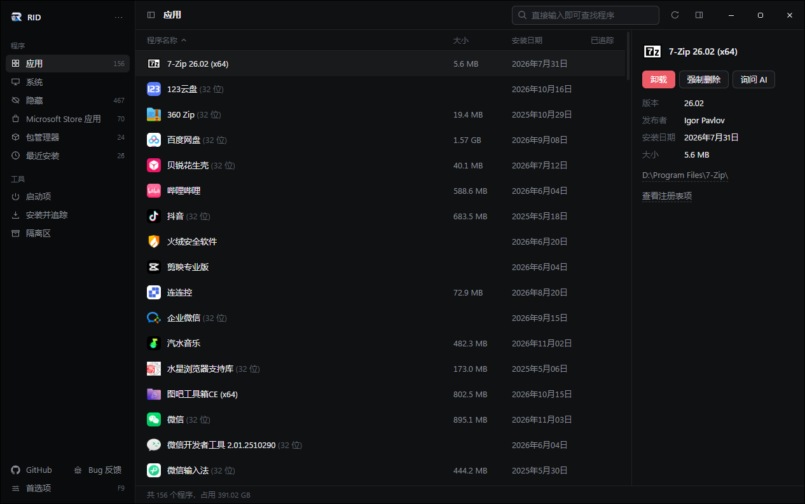
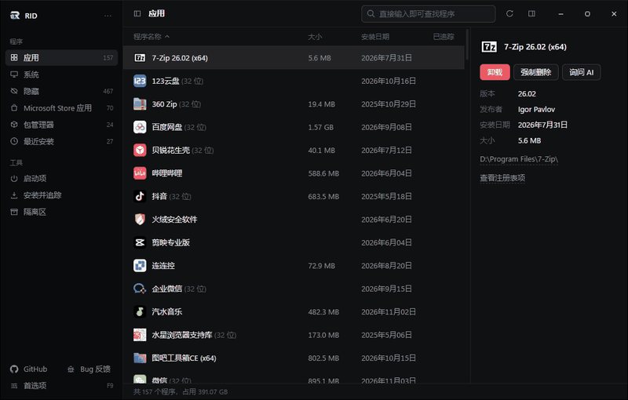

<div align="center">


# RID Uninstaller

**把程序卸干净，而且删错了能找回来。**

Windows 上的卸载工具：卸载程序、清理残留、管理启动项。开源、免费、没有广告。用 Rust 编写，界面基于 Tauri。

[](https://github.com/Buggo404/RID-Uninstaller/releases/latest)
[](LICENSE)


[下载](https://github.com/Buggo404/RID-Uninstaller/releases/latest) · [Bug 反馈](https://github.com/Buggo404/RID-Uninstaller/issues) · [English](#english)



</div>

---

## 它解决什么问题

系统自带的“卸载”只是运行程序自己的卸载器，留下的文件夹、注册表项、服务和快捷方式没人管。而很多清理工具的问题正好相反：按名字一通匹配，把别的程序甚至你的文档一起删了。

RID 的做法是**每一项残留都要说得出理由，每一次删除都能撤销**。

下面是完整的一次过程：卸载、检查残留（每一项后面是它被找到的依据）、删除，再从隔离区原样还原。

<div align="center">

</div>

## 下载与安装

到 [Releases](https://github.com/Buggo404/RID-Uninstaller/releases/latest) 下载 `RID-Uninstaller-<版本>-setup.exe`，支持 Windows 10 / 11（x64）。

- **安装包还没有代码签名**，首次运行时 Windows SmartScreen 会提示“未知发布者”，点“更多信息 → 仍要运行”。介意的话可以对照同一页的 `SHA256SUMS.txt` 校验文件，或者[自己构建](#构建)。
- 安装包由 [GitHub Actions](https://github.com/Buggo404/RID-Uninstaller/actions) 从本仓库的代码直接编译，过程公开可查。
- 装好之后程序会自己检查新版本。更新包必须带有与程序内置公钥匹配的签名才会被接受。

## 功能

| | |
| --- | --- |
| **卸载** | 注册表登记的程序、MSI、Microsoft Store 应用，以及 Steam、Scoop、Chocolatey 安装的内容，都在一个列表里 |
| **残留扫描** | 卸载后查找剩下的文件夹、注册表项、服务、快捷方式；每一项都标明依据，只有确定属于该程序的才默认勾选 |
| **强制删除** | 卸载器坏了或者早就不存在的程序，直接按残留扫描的结果清理 |
| **批量与静默** | 一次选多个；卸载器支持时可全程不弹窗 |
| **隔离区** | 删除的内容先移入隔离区，可以整批还原；保留时长可设，也可以选择直接永久删除 |
| **安装追踪** | 通过 RID 运行安装包，记录它创建的每一个文件和注册表项，卸载时照单清理；基于 Windows 自带的事件追踪（ETW），不装驱动 |
| **启动项** | 注册表 Run、启动文件夹、计划任务、Store 应用的开机任务，统一查看、禁用、删除、添加 |
| **右键菜单** | 在资源管理器里对快捷方式直接“卸载”，对安装包“安装并追踪” |
| **AI 分析** | 右键任意程序、启动项或残留项选择“询问 AI”，根据名称、发布者和目录内容说明它是什么、做什么用 |
| **命令行** | `rid list`、`rid scan`、`rid uninstall` 等，适合脚本和批量环境 |
| **更新** | 把 WinGet、Scoop、Chocolatey、npm、pip、Cargo、.NET Tool、vcpkg 的可用更新集中列出，可单项或一键更新；程序列表里也能看到哪个程序有新版本 |
| **安装方式** | 识别 MSI、Inno Setup、NSIS、WiX Burn、Squirrel 等，据此选用静默参数，安装追踪时自动填入 |

界面支持简体中文、英文和巴西葡萄牙语（由 [stokeer](https://github.com/stokeer) 贡献），深色、浅色跟随系统。欢迎提交其他语言的翻译：只需要在 `client/crates/rid-app/ui/src/i18n.ts` 里加一张表。

## 为什么不会误删

这是这个项目最在意的部分。

- **有护栏**：Windows 目录、Program Files 根目录、用户文档等位置，以及其他已安装程序的目录，无论扫描结果怎样都拒绝删除。删除前会对每一项重新检查一遍。
- **有依据**：残留项带着它被找到的原因（安装位置、卸载器所在目录、名称匹配、安装记录……）。只凭名称相似找到的项不会默认勾选。
- **看得见文档**：文件夹里如果有文档类文件，会明确提示数量。
- **能反悔**：默认所有删除都进隔离区，文件原样保留，注册表先导出再删。

## 权限与隐私

**为什么需要管理员权限**：大多数程序装在 `Program Files`、登记在 `HKEY_LOCAL_MACHINE`，清理它们的残留、结束占用文件的进程、追踪安装过程，都需要管理员权限。

**什么时候联网**，只有这三种情况：

| 时机 | 发出的内容 |
| --- | --- |
| 扫描某个程序的残留 | 该程序的名称，用来查询它的残留规则 |
| 检查更新 | 不带任何信息，只取回最新版本的说明 |
| 你主动点“询问 AI” | 被询问那一项的登记信息（名称、版本、发布者、安装路径、卸载命令等）和它目录里的文件名（最多 40 个）；路径中的用户名在发出前会被替换掉 |

没有账号，没有统计，没有遥测；服务器只有网站都有的访问日志。服务端同样在本仓库里，可以[自己部署](#服务端)，编译时用 `RID_SERVER` 指向它。

## 和同类工具的区别

| | RID | Geek Uninstaller | Revo Uninstaller | Bulk Crap Uninstaller |
| --- | --- | --- | --- | --- |
| 开源 | MIT | 否 | 否 | Apache-2.0 |
| 价格 | 免费 | 个人免费 | 免费版 + 付费 Pro | 免费 |
| 删错了怎么找回 | 隔离区，文件和注册表整批还原 | 无 | 还原点、注册表备份，文件进回收站 | 注册表备份，文件进回收站 |
| 安装追踪 | 有 | 无 | 仅 Pro | 无 |

它们各有 RID 比不上的地方：Geek 是一个免安装的单文件，还有 ARM64 版；Bulk Crap Uninstaller 在大批量无人值守卸载上做得最深；Revo 有自己维护的程序日志库。表中信息来自各项目的官网和手册（2026 年 11 月），有不准确的地方请提 issue。

## 当前状态

项目还很新（0.1.x），核心功能都已可用，欢迎试用和反馈。

| 部分 | 状态 |
| --- | --- |
| 卸载、残留扫描、隔离区、启动项、右键菜单、命令行 | 可用 |
| 安装追踪 | 可用；MSI 安装包的追踪测试还不充分 |
| 更新检查与一键更新 | 可用；WinGet 的列表靠解析它的表格，界面是英文或中文时最稳 |
| AI 分析 | 可用；模型在服务端后台配置（兼容 OpenAI 与 Anthropic 接口），提示词可按功能分别修改 |
| 代码签名、WinGet、ARM64、更多语言 | 计划中 |

## 构建

需要 Windows 10/11 x64，以及：

- Rust（stable，支持 2024 edition）
- Node.js 24 与 pnpm 10

```powershell
cd client
.\scripts\build.ps1
```

脚本会依次运行测试、构建命令行和程序本体，产物是安装包 `client\target\release\bundle\nsis\Rid Uninstaller_<版本>_x64-setup.exe`。

程序默认连接 `https://rid.bitheart.top`；编译时设置环境变量 `RID_SERVER` 可以指向别的服务器（例如本机的测试服务）。

开发界面：

```powershell
cd client\crates\rid-app
pnpm install
pnpm tauri dev
```

### 服务端

规则库、更新检查和管理后台，基于 Node.js、Vue 3 和 PostgreSQL，用 Docker 启动：

```powershell
cd server
Copy-Item .env.example .env   # 填写数据库密码和管理员令牌
docker compose up -d --build
```

管理后台在 `/admin`。初始管理员密码只在首次启动的日志里出现一次，登录后必须修改。

常见程序的残留规则在 `server/seed/rules.txt`，用 `node scripts/seed.mjs` 导入；某个程序对应的键用 `rid key "<程序名称>"` 得到。

## 目录

```
client/
  crates/rid-core     枚举、扫描、安全护栏、删除与还原（不依赖界面）
  crates/rid-app      桌面程序（Tauri + Vue 3）
  crates/rid-cli      命令行
server/               规则库、更新、管理后台
```

## 反馈

遇到问题请到 [Issues](https://github.com/Buggo404/RID-Uninstaller/issues) 提交。如果是误删或漏删，附上程序名称和相关路径会很有帮助——这类问题优先处理。

## 致谢

更新检查的思路参考了 [UniGetUI](https://github.com/Devolutions/UniGetUI)（MIT，C#）。RID 没有使用它的代码：包管理器的输出解析和命令拼装在 `client/crates/rid-core/src/updates.rs` 里用 Rust 重写，安装包类型的判断在 `installer.rs`。

## 许可证

[MIT](LICENSE)

<a href="https://star-history.com/#Buggo404/RID-Uninstaller&Date"></a>

---

## English

RID Uninstaller removes Windows programs completely, and lets you take it back. It runs the program's own uninstaller, then finds what was left behind (folders, registry keys, services, shortcuts) and removes it. Open source (MIT), free, no ads. Written in Rust with a Tauri interface.

**[Download the latest release](https://github.com/Buggo404/RID-Uninstaller/releases/latest)** for Windows 10 / 11 x64. The installer is not code-signed yet, so SmartScreen shows "unknown publisher"; it is built from this repository by GitHub Actions and comes with `SHA256SUMS.txt`.

- **Every leftover has a reason.** Each item shows the evidence it was found by (install location, shortcut target, publisher and name, an install trace). Items found by a similar name alone are not selected by default.
- **Guardrails.** The Windows folder, the Program Files root, your documents and other installed programs' folders are refused no matter what a scan says.
- **Everything can be undone.** Removed files and registry keys go to a quarantine and can be restored as a whole.
- **Install tracing without a driver.** Run a setup program through RID and it records every file and registry key the setup creates, using Windows' own event tracing (ETW).
- **Also:** force removal for broken uninstallers, batch and silent uninstall, Store apps, packages from Steam, Scoop and Chocolatey, a startup manager, an Explorer context menu, a command-line tool, and an optional "Ask AI" about any program or leftover.
- **Updates in one place.** WinGet, Scoop, Chocolatey, npm, pip, Cargo, .NET Tool and vcpkg are checked side by side; install one or all, and the program list marks the programs that have a newer version.
- **Installer detection.** MSI, Inno Setup, NSIS, WiX Burn and Squirrel are recognised, which is how the silent switches are chosen and how the install-and-trace dialog fills its arguments.
- **Credits.** The idea of checking every package manager in one place follows [UniGetUI](https://github.com/Devolutions/UniGetUI) (MIT). None of its code is used: the output parsing and command building live in `updates.rs`, written in Rust for this project.

**Privacy.** The program goes online in three cases only: looking up leftover rules for a program you are scanning (sends its name), checking for updates, and when you choose "Ask AI" (sends that item's listed details such as name, version, publisher, install path and uninstall command, plus up to 40 file names from its folder, with your user name removed from paths). No account, no analytics, no telemetry. The server is in this repository too and can be self-hosted.

The interface is in English, Simplified Chinese and Brazilian Portuguese (contributed by [stokeer](https://github.com/stokeer)) and follows the system's light or dark theme. Translations are welcome: a language is one more table in `client/crates/rid-app/ui/src/i18n.ts`. Build it with `client\scripts\build.ps1`.
